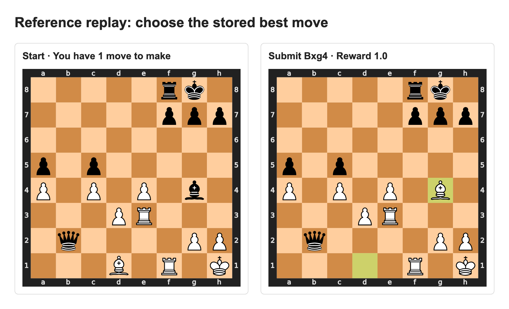
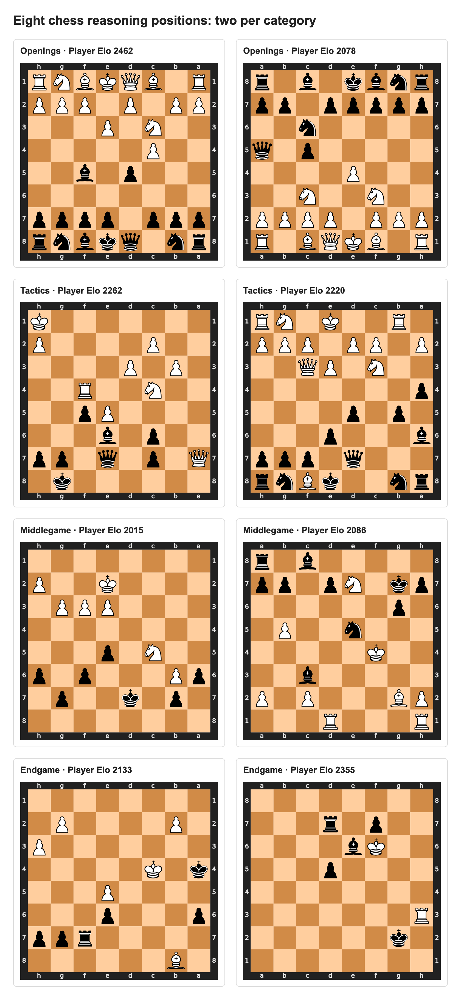

# Train a model to reason about chess

Let's teach a model to find the best chess move!

Inspired by Claude Shannon's 1950 paper,
[*Programming a Computer for Playing Chess*](https://www.computerhistory.org/chess/doc-431614f453dde/),
we train models to choose a strong move from a given position. This cookbook takes
you from data to ingestion, evaluation, and training with the Trajectory SDK.

The cookbook has six sections:

1. [Dataset](#dataset): annotated positions, categories, and distribution.
2. [Harness](#harness): reasoning and Python agents, with an example trace.
3. [Ingestion](#ingestion): upload both variants.
4. [Eval](#eval): compare ten models on the same 100 positions.
5. [Train](#train): train two models with both agents and compare before and after.
6. [Appendix](#appendix): sources, board previews, and local checks.

## Dataset

We use four curated, preannotated sets: **openings, tactics, middlegames, and
endgames**. Each source set has 50,000 training positions and 250 held-out positions.
Most come from [Lichess rated game exports](https://database.lichess.org/#standard_games),
with additional games from [Lichess Elite archives](https://database.nikonoel.fr/)
and Chess.com. Each record keeps its source game,
player ratings, Stockfish 19 scores, alternative moves, and principal variations.

The reference move agrees across searches at **30,000 and 180,000 nodes**. Held-out
positions also have a **2,000,000-node recheck**. These are frozen engine labels,
not a proof of perfect play. We select a smaller, deterministic tutorial subset:

| Split | Per category | Total |
| --- | ---: | ---: |
| Training | 1,250 | 5,000 |
| Evaluation | 25 | 100 |

Both agents use these same positions. Player Elo belongs to the side to move;
it is not a puzzle rating. Categories are balanced; rating counts follow the
source data.

Each line in [`data/positions.jsonl`](data/positions.jsonl) is one task. Here are
the task fields for a tactical position; the full record also keeps the engine
annotations and source game:

```jsonl
{"position_id":"087b256a0aba982113d7f99a235a18e99af82e364b4aed27eb4c5f7e0d65ea66","split":"test","category":"tactics","player_rating":2060,"rating_band":"2000-2199","fen":"5rk1/5ppp/8/p1p5/P1P1P1b1/3PR3/1q4PP/3B1R1K w - - 0 28","solution":["d1g4"]}
```



White submits **Bxg4** (`d1g4`), matching the stored best move for **reward 1.0**.
The task ends after one submission. Explore [eight board previews](visuals/positions.png)
and their [records](visuals/positions.jsonl), with two positions per category.


The [manifest](data/positions.manifest.json) records source-file hashes, selection,
and split counts. [Chart counts](visuals/dataset-distribution.json) are generated
from the checked-in positions. The subset contains 5,072 Lichess positions and 28
Chess.com opening positions, with player Elo from 2000 to 3394.

## Harness

Both agents receive the board and FEN, then call `submit_move` once. Reward is
**1.0 for the stored best UCI move and 0.0 for any other move**. Engine scores,
reference moves, and principal variations stay in the grader.

### Reasoning

[`harness/reasoning_harness.py`](harness/reasoning_harness.py) starts the shared
loop with only `submit_move`. The model gets one response, capped at 4,000 output
tokens. Its instructions include:

```text
Play the best move in this chess position.
You have 1 move to make with submit_move.
Consider candidate moves, forcing lines, and the opponent's strongest replies.
```

### Python

[`harness/python_harness.py`](harness/python_harness.py) also offers `python_chess`.
It allows **50 model turns total**, shared between calculations and the final
submission, with **4,000 output tokens per response**:

```text
Use python_chess to calculate with python-chess.
Each call gets a fresh board at the current position.
Reserve a turn to submit your final move.
```

Calculations can explore either side's moves on a copy of the board. They do not
change the task position. The agent submits only its chosen root move; the harness
does not play an opponent reply in this one-move task. No engine is available to
either agent.

Python runs in an isolated Linux x86-64 worker with no network, credentials, or
reference files. Calls have 10 CPU seconds, 15 wall seconds, 256 MiB memory, and
16 KiB output. Read the [shared loop and grader](harness/chess_harness.py) and
[Python worker](harness/python_tool.py).

### Example trace

The [reference replay](visuals/reasoning-trace.json) shows the exact prompt,
submission, final board, and reward. It is scripted and makes zero model calls:

```text
Harness: Play the best move. You play White. [board and FEN]
         You have 1 move to make with submit_move.
Replay:  submit_move({"move": "d1g4"})
Result:  reward=1.0, model_turns=1, python_calls=0
```

Reproduce it from the cookbook root:

```bash
uv run examples/chess/scripts/trace.py
```

See [`scripts/trace.py`](scripts/trace.py) for the replay client.

<!-- Add a platform screenshot here after new best-move diagnostics pass. -->

## Ingestion

Set a staging API key and choose your agent:

```bash
export TRAJECTORY_BASE_URL="https://staging.api.trajectory.ai"
export TRAJECTORY_API_KEY="YOUR_STAGING_KEY"
AGENT_NAME="CHESSSS"

uv run examples/chess/scripts/ingest.py --agent-name "$AGENT_NAME" --variant reasoning
uv run examples/chess/scripts/ingest.py --agent-name "$AGENT_NAME" --variant python
```

Each command diagnoses one task, uploads the 5,000/100 split, waits for the shared
image build, and runs a benchmark diagnostic. The task command selects the agent:

```python
TaskSpec(
    name=f"chess/{variant}/{record['category']}/{record['position_id']}",
    split=record["split"],
    run_command=f"python -u /opt/chess/{variant}_harness.py",
    env_vars={
        "CHESS_VARIANT": variant,
        "CHESS_POSITION": json.dumps(record),
    },
)
```

The parent process keeps the labels; the Python worker receives only the FEN and
model code. Save the printed operation and benchmark IDs. Check an interrupted
operation before starting another upload. See [`ingest.py`](scripts/ingest.py).

```bash
REASONING_BENCH_ID="YOUR_NEW_REASONING_BENCH_ID"
PYTHON_BENCH_ID="YOUR_NEW_PYTHON_BENCH_ID"
```

Use new benchmark IDs for this best-move task. Earlier mate benchmarks use different
prompts, labels, and grading.

<!-- Add a platform screenshot after both new benchmark uploads pass. -->

## Eval

Run ten models with both agents:

```bash
uv run examples/chess/scripts/evaluate.py \
  --reasoning-bench-id "$REASONING_BENCH_ID" \
  --python-bench-id "$PYTHON_BENCH_ID"
```

The [model list](scripts/evaluate.py) contains six open-weight and four closed-weight
models. Availability and options are checked before starting any job.

| Open weights | Closed weights |
| --- | --- |
| Qwen3.5-4B | GPT-6.1 Sol |
| Qwen3.6-35B-A3B | Claude Opus 5.5 |
| Qwen3.8-27B | Claude Sonnet 5.5 |
| Qwen3.5-397B-A17B | Gemini 3.1 Pro Preview |
| Nemotron 3.5 Lightning 30B-A3B | |
| Nemotron 3.5 Super 120B-A12B | |

Each of the **20 jobs** runs **100 positions × 4 independent attempts = 400
rollouts**, for **8,000 baseline rollouts**. Each attempt starts fresh. Results
include pass@1–4, exact-move accuracy, and mean Python calls and model turns,
broken down by category and player Elo. Rating groups include their sample counts;
empty groups are left blank in plots.

Pass@k is calculated per position, then averaged. One success in four attempts
gives pass@1 = 0.25 and pass@4 = 1.0. The script requires all 400 graded attempts
and stops on infrastructure failures or missing metrics.

| Plot | What it shows |
| --- | --- |
| `eval-models.png` | Pass@1–4 by model and agent |
| `eval-usage.png` | Mean Python calls and model turns |
| `eval-rating.png` | Pass rates and tool use by player Elo |
| `eval-category.png` | Pass rates and tool use by category |

The platform ceilings allow 204,000 output tokens and 104 total turns per
trajectory, with a 3,600-second timeout. The harness enforces one reasoning turn or
50 Python-agent turns. Generation settings stay fixed across agents for a model.

Reports and job IDs go to `results/best-move/`. Repeating the command resumes those
IDs. Use a fresh results directory if benchmark versions or settings change.

<!-- Add measured plots and a platform screenshot after the 20 jobs complete. -->

## Train

Train Qwen3.5-4B and Qwen3.6-35B-A3B with both agents, giving **four runs**:

```bash
uv run examples/chess/scripts/train.py \
  --reasoning-bench-id "$REASONING_BENCH_ID" \
  --python-bench-id "$PYTHON_BENCH_ID" \
  --num-steps 100
```

Each run uses all 5,000 training positions:

```python
{
    "num_steps": 100,
    "batch_size": 16,
    "group_size": 8,
    "max_concurrent_trajectories": 128,
    "val_enabled": False,
}
```

That is at least 12,800 training rollouts per run. Groups without a learning signal
can add attempts; the script stops a stalled run after 24 hours or four times that
minimum. It verifies 100 completed optimizer steps before evaluating checkpoint 100.

The four checkpoint evaluations reuse the same 100 positions, four attempts per
position, and baseline generation settings. They add **1,600 rollouts**, giving
**9,600 evaluation rollouts** including baselines, separate from training.

Regenerate plots after checkpoint evaluation:

```bash
uv run examples/chess/scripts/evaluate.py --plot-only
```

`visuals/before-after.png` compares pass rates and tool use for the four runs.
See [`train.py`](scripts/train.py) for training, checkpoint evaluation, and collection.

<!-- Add platform training curves and measured before/after plots after completion. -->

## Appendix

### Sources and annotations

- [Lichess game exports](https://database.lichess.org/#standard_games): most positions
  come from the January 2016 rated-game archive; each record names its archive and game.
- [Lichess Elite archives](https://database.nikonoel.fr/): additional Lichess games,
  with the exact monthly archive recorded in each position's `source`.
- Chess.com opening positions retain their original game and archive links in `source`.
- [`data/positions.manifest.json`](data/positions.manifest.json): source-file hashes,
  original 50,000/250 splits, deterministic selection, and frozen label policy.
- [`data/positions.jsonl`](data/positions.jsonl): all selected tasks, with engine
  alternatives, principal variations, search budgets, and source metadata.
- [Trajectory Cookbook README](../../README.md): SDK setup and other examples.

The original curated sources are `openings-v3.jsonl`, `tactics-v3.jsonl`,
`middlegame-v3.jsonl`, and `endgame-v3.jsonl`. To rebuild from those files:

```bash
uv run examples/chess/scripts/dataset.py --source-dir /path/to/curated-sources
```

The builder preserves the original train/test assignments and checks unique boards,
source-game separation, legal reference lines, stable best moves across recorded
searches, and deeper held-out rechecks. It does not call Stockfish again.

### Board previews



Rebuild the chart, reference-move visual, and previews:

```bash
uv run --with playwright playwright install chromium
uv run examples/chess/scripts/visualize.py
```

### Files and local checks

```text
chess/
├── README.md
├── data/       # Selected positions and source manifest
├── harness/    # Two agents, shared grader, isolated Python worker, and Dockerfile
├── scripts/    # Dataset selection, ingestion, evaluation, training, and previews
├── tests/      # Offline checks
└── visuals/    # Boards, distribution, replay, and measured result plots
```

```bash
uv run --with trajectory-sdk==0.9.37 --with chess==1.11.2 --with pytest \
  pytest -q examples/chess/tests/test_chess.py
```
