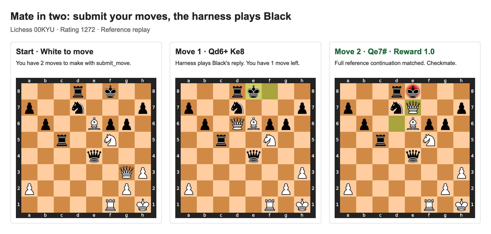
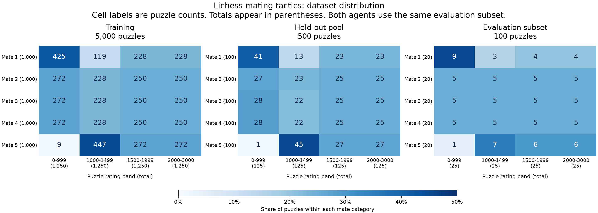
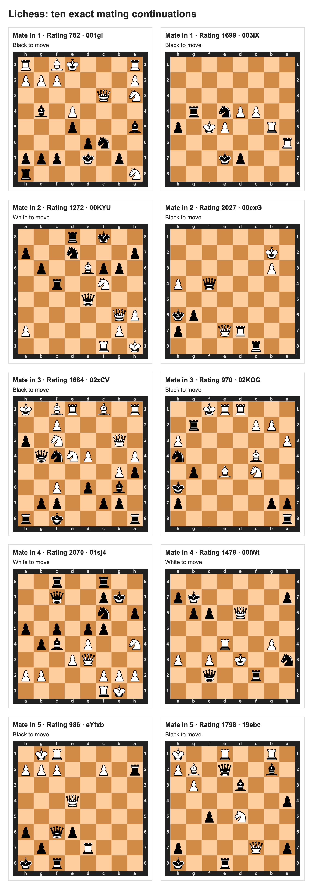

# Train a model to solve Lichess Mating Tactics

Let's teach a model to deliver checkmate!

Inspired by Claude Shannon's 1950 paper,
[*Programming a Computer for Playing Chess*](https://www.computerhistory.org/chess/doc-431614f453dde/),
we train models on a simpler variant of chess: finish a forcing checkmate from a
given position.

This cookbook takes you from data to ingestion, evaluation, and training with the
Trajectory SDK. You'll compare two agents: one uses reasoning alone, and the other
can calculate with Python and `python-chess`.

The cookbook has six sections:

1. [Dataset](#dataset): Lichess puzzles, splits, and rating distribution.
2. [Harness](#harness): the two agents, move handling, and an example trace.
3. [Ingestion](#ingestion): upload both variants to Trajectory.
4. [Eval](#eval): compare ten models on the same puzzles.
5. [Train](#train): train two models with both agents and compare before and after.
6. [Appendix](#appendix): sources, previews, and local checks.

## Dataset

We use puzzles from the [Lichess open database](https://database.lichess.org/#puzzles),
released under [CC0](https://creativecommons.org/publicdomain/zero/1.0/). Each asks for
mate in 1–5 moves, with every solver move giving check.

| Split | Puzzles | Per mate length |
| --- | ---: | ---: |
| Training | 5,000 | 1,000 |
| Held-out pool | 500 | 100 |
| Evaluation, selected from the held-out pool | 100 | 20 |

Puzzle ratings range from 0 to 3000. Each split is evenly divided across four
bands: **below 1000**, **1000–1499**, **1500–1999**, and **2000–3000**. Counts vary
within each mate category because easy mate-in-5 puzzles are scarce.

Each line in [`data/puzzles.jsonl`](data/puzzles.jsonl) holds one puzzle. Here are
example `00KYU`'s task fields: `fen` is the starting board, and `solution` is the
full continuation in UCI notation, including the opponent's replies.

```jsonl
{"puzzle_id":"00KYU","split":"test","mate_in":2,"rating":1272,"rating_band":"1000-1499","fen":"3r1k2/p2n3p/1p2Bpp1/2r2N2/4q3/6QP/P5P1/5R1K w - - 2 41","solution":["g3d6","f8e8","d6e7"]}
```



Play **Qd6+**, let the harness reply **Ke8**, then finish with **Qe7#**.
Match the full reference line to earn **reward 1.0**.



## Harness

Both harnesses ask the model to call `submit_move` for each of its moves. The
harness checks the move, plays the opponent's reply, and returns the new position.
The reference solution stays in the harness.

For the mate-in-2 puzzle above, the conversation is:

```text
Harness: You have 2 moves to make with submit_move. [starting board and FEN]
Model:   submit_move({"move": "g3d6"})
Harness: Correct. Black played f8e8. You have 1 move to make with submit_move.
         [new board and FEN]
Model:   submit_move({"move": "d6e7"})
Harness: Full continuation matched. Reward: 1.0.
```

The model must complete the exact reference continuation. A different move scores
0.0, including another legal checkmate. The harness records partial progress for
analysis, but it does not give partial reward.

### Example trace

Open the [full reference replay](visuals/reasoning-trace.json) to see the exact
prompt, move submissions, updated board, and final grade for puzzle `00KYU`.
This is a scripted replay through the reasoning harness, with zero model calls.

After `submit_move({"move": "g3d6"})`, the harness returns these fields, along with
the updated board:

```json
{
  "your_move": "g3d6",
  "opponent_move": "f8e8",
  "fen": "3rk3/p2n3p/1p1QBpp1/2r2N2/4q3/7P/P5P1/5R1K w - - 4 42",
  "moves_remaining": 1,
  "instruction": "You have 1 move to make with submit_move."
}
```

The next submission, `submit_move({"move": "d6e7"})`, completes the line. The
replay records reward `1.0`, two model turns, two correct solver moves, and three
correct half-moves, including Black's automatic reply.

To reproduce the trace from the cookbook root:

```bash
uv run examples/chess/scripts/trace.py --puzzle-id 00KYU
```

See [`scripts/trace.py`](scripts/trace.py) for the replay client and
[`play()` in the shared harness](harness/chess_harness.py) for move handling.

### Reasoning

[`harness/reasoning_harness.py`](harness/reasoning_harness.py) starts the shared
loop with only `submit_move` available:

```python
from chess_harness import main

if __name__ == "__main__":
    main("reasoning")
```

The model gets one response per solver move, up to five responses for mate in 5.

### Python

[`harness/python_harness.py`](harness/python_harness.py) adds `python_chess`:

```python
from chess_harness import main

if __name__ == "__main__":
    main("python")
```

This agent gets 50 model turns, shared between calculations and move submissions.
Its prompt includes:

```text
You have at most 50 model turns total, including Python calls and move submissions.
Use python_chess to calculate with python-chess. Each call gets a fresh board
at the current position. Reserve enough turns to submit every move.
```

A Python calculation does not change the puzzle board. The model still needs to
call `submit_move` to play. Each calculation starts with `chess` and a fresh `board`
at the current FEN. There is no chess engine.

Both agents allow 4,000 output tokens per response. Python runs in an isolated
Linux x86-64 worker with no network, credentials, or reference files. Each call
has 10 CPU seconds, 15 wall seconds, 256 MiB memory, and 16 KiB output.

Read [`harness/chess_harness.py`](harness/chess_harness.py) for the model loop and
grader, and [`harness/python_tool.py`](harness/python_tool.py) for the worker.

<!-- Add visuals/platform-harnesses.png here after diagnostics. Show one real
     trajectory from each harness, including submissions and opponent replies. -->

## Ingestion

Set a staging API key and choose an existing agent. The commands below use
`CHESSSS`; replace it with your agent's name if needed.

```bash
export TRAJECTORY_BASE_URL="https://staging.api.trajectory.ai"
export TRAJECTORY_API_KEY="YOUR_STAGING_KEY"
AGENT_NAME="CHESSSS"

uv run examples/chess/scripts/ingest.py --agent-name "$AGENT_NAME" --variant reasoning
uv run examples/chess/scripts/ingest.py --agent-name "$AGENT_NAME" --variant python
```

Each command first diagnoses one task, then uploads 5,000 training puzzles and the
shared 100-puzzle test set. It waits for the image build and runs a benchmark
diagnostic before returning.

The uploader creates one task per puzzle. The important fields are:

```python
TaskSpec(
    name=f"chess/{variant}/mateIn{puzzle['mate_in']}/{puzzle['puzzle_id']}",
    split=puzzle["split"],
    run_command=f"python -u /opt/chess/{variant}_harness.py",
    env_vars={
        "CHESS_VARIANT": variant,
        "CHESS_PUZZLE": json.dumps(puzzle),
    },
)
```

Both variants share an image. The task command selects the harness, and its
environment supplies the puzzle to the parent process. The Python worker receives
only the current FEN and the model's code.

Save the printed operation and benchmark IDs. If an upload is interrupted, check
its operation ID before starting another one. Use the same benchmark versions for
all evaluations and training comparisons. See [`ingest.py`](scripts/ingest.py).

```bash
REASONING_BENCH_ID="YOUR_REASONING_BENCH_ID"
PYTHON_BENCH_ID="YOUR_PYTHON_BENCH_ID"
```

<!-- Add visuals/platform-ingestion.png here after both uploads pass. Show the
     benchmark versions, 5,000/100 task splits, and ready runtime status. -->

## Eval

Run the evaluation script with those two benchmark IDs:

```bash
uv run examples/chess/scripts/evaluate.py \
  --reasoning-bench-id "$REASONING_BENCH_ID" \
  --python-bench-id "$PYTHON_BENCH_ID"
```

The model list in [`evaluate.py`](scripts/evaluate.py) contains six open-weight models and
four closed-weight models:

| Open weights | Closed weights |
| --- | --- |
| Qwen3.5-4B | GPT-6.1 Sol |
| Qwen3.6-35B-A3B | Claude Opus 5.5 |
| Qwen3.8-27B | Claude Sonnet 5.5 |
| Qwen3.5-397B-A17B | Gemini 3.1 Pro Preview |
| Nemotron 3.5 Lightning 30B-A3B | |
| Nemotron 3.5 Super 120B-A12B | |

Each model runs with both harnesses: **20 jobs**. Each job makes four independent
attempts at each of the 100 test puzzles: **400 rollouts per job**, or **8,000 total**.
Every attempt starts with a fresh conversation and board.

Before starting, the script checks the model catalog and confirms that both
benchmarks contain the same test puzzles. It saves each evaluation ID before
waiting for results. Running the command again with the same result directory
continues from those IDs.

The model settings include:

```python
{
    "val_num_tasks": 100,
    "val_trajectories_per_task": 4,
    "max_output_tokens_per_turn": 4000,
    "max_output_tokens_per_trajectory": 204000,
    "max_turns_per_trajectory": 104,
    "trajectory_timeout_seconds": 3600,
}
```

The larger platform limits leave room for 50 model responses and their tool
results. The Python harness still stops after 50 model turns. Thinking and sampling
settings are held fixed for a model's two harnesses and checkpoint comparisons.

The report includes pass@1 through pass@4. If a puzzle is solved once in four
attempts, its pass@1 estimate is 0.25 and its pass@4 estimate is 1.0. Scores are
calculated per puzzle, then averaged across the 100 puzzles.

Partial progress is reported separately. For example, matching `Qd6+ Ke8` before
getting White's next move wrong gives two correct half-moves and one correct
solver move, while reward stays 0.0. Automatic opponent replies count toward the
half-move prefix, but not toward the model's solver-move count.

After all jobs finish, the script writes four plots to `visuals/`:

| Plot | What it shows |
| --- | --- |
| `eval-models.png` | Pass@1–4 for each model and harness |
| `eval-prefix.png` | Mean correct half-moves and solver moves |
| `eval-rating.png` | Scores and correct prefixes by rating band |
| `eval-mate-length.png` | Scores and correct prefixes by mate length |

Check failure and completion counts before comparing scores. The script requires
400 graded attempts per job and stops on missing grades or infrastructure failures.

<!-- Add visuals/platform-evaluation.png and the four measured plots here after
     completion. The platform screenshot should show the twenty evaluation jobs. -->

## Train

Use the same benchmark IDs to train Qwen3.5-4B and Qwen3.6-35B-A3B with both
harnesses. This creates four training runs:

```bash
uv run examples/chess/scripts/train.py \
  --reasoning-bench-id "$REASONING_BENCH_ID" \
  --python-bench-id "$PYTHON_BENCH_ID" \
  --num-steps 100
```

Each run uses all 5,000 training puzzles with these settings:

```python
{
    "num_steps": 100,
    "batch_size": 16,
    "group_size": 8,
    "max_concurrent_trajectories": 128,
    "val_enabled": False,
}
```

A batch has 16 task groups with eight rollouts each. That is at least 12,800 training
rollouts per run for 100 steps. Groups without a learning signal can increase the
number of attempts. To bound a stalled run, the script stops after 24 hours or four
times that minimum rollout count.

The script reuses the four matching baselines from the evaluation step. After each
training run succeeds, it checks the completed optimizer steps, retrieves checkpoint
100, and evaluates that checkpoint on the same 100 puzzles with four attempts each.
Those four final evaluations add **1,600 rollouts**. Baseline and final evaluations
therefore total **9,600 rollouts**, separate from training.

Once the checkpoint evaluations finish, regenerate the plots:

```bash
uv run examples/chess/scripts/evaluate.py --plot-only
```

This adds `visuals/before-after.png`, comparing solve rates and correct half-move
prefixes for the four runs. Reports and job IDs are saved under `results/`. Keep
those files to resume a command. Use a new results directory when changing benchmark
versions or settings, so an old run cannot be mistaken for the new comparison.

See [`train.py`](scripts/train.py) for checkpoint evaluation and result collection.

<!-- Add visuals/platform-training.png, visuals/before-after.png, and a platform
     training-curve screenshot here after the four runs finish. Include the actual
     optimizer steps and checkpoint IDs with the results. -->

## Appendix

### Sources

- [Lichess puzzle dataset and format](https://database.lichess.org/#puzzles): source
  fields, UCI moves, ratings, and the setup move that must be applied before solving.
- [Lichess puzzle download](https://database.lichess.org/lichess_db_puzzle.csv.zst):
  the source CSV used by [`dataset.py`](scripts/dataset.py).
- [CC0 license](https://creativecommons.org/publicdomain/zero/1.0/): the license for
  the Lichess database exports.
- [`puzzles.manifest.json`](data/puzzles.manifest.json): the source URL, checksum of the
  generated puzzle file, split counts, and forcing-move filter.
- [Trajectory Cookbook README](../../README.md): SDK setup, examples, and guides.

### Dataset checks and previews

The loader checks legal moves, line length, checks, and final checkmate. Training
and held-out puzzles share no puzzle IDs, source games, or starting positions.
Mate labels come from Lichess; replay does not prove the shortest mate against
every defense. Only ten source puzzles are all-check mate-in-5 below rating 1000.

See the [distribution counts](visuals/dataset-distribution.json) and
[ten preview records](visuals/puzzles.jsonl) for the data behind the images.



Rebuild the distribution chart, walkthrough, and previews from the cookbook root:

```bash
uv run --with playwright playwright install chromium
uv run examples/chess/scripts/visualize.py
```

### Files

The files are grouped by purpose:

```text
chess/
├── README.md
├── data/       # Full puzzle dataset and manifest
├── harness/    # Two agents, shared grader, Python worker, and Dockerfile
├── scripts/    # Dataset preparation, ingestion, evaluation, training, and previews
├── tests/      # Local checks
└── visuals/    # Puzzle images, serialized previews, traces, and result plots
```

### Local checks

Run the tests locally without starting managed jobs:

```bash
uv run --with trajectory-sdk==0.9.37 --with chess==1.11.2 --with zstandard --with pytest \
  pytest -q examples/chess/tests/test_chess.py
```
