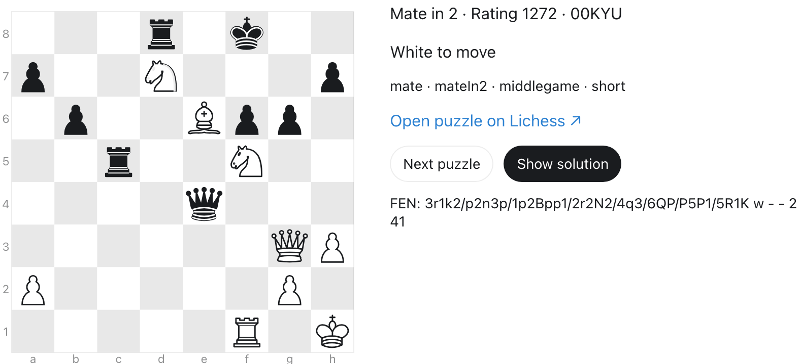
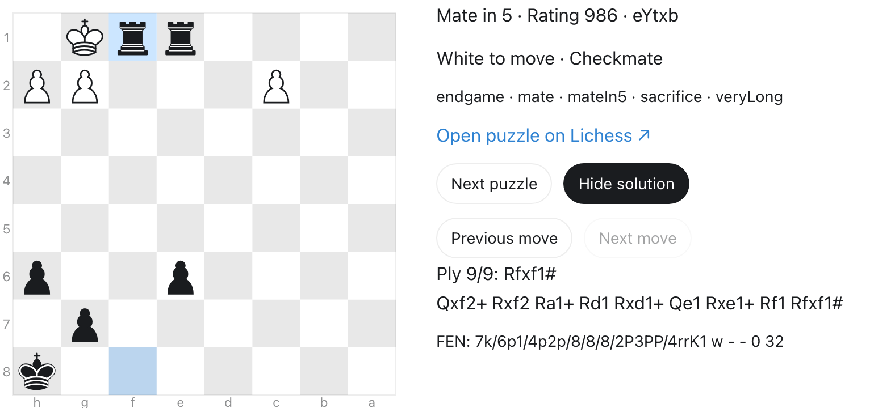

# Chess: puzzles → agents → evaluation → training

**Code outline for review.** Helpers below are pseudocode unless imported from the
SDK. Screenshots show real puzzles. Model comparison and training results are pending.
The snippets below have not been executed.

## 1. Puzzle and solution: JSONL

One JSON object per line. These records come from [`puzzles.jsonl`](puzzles.jsonl):

```jsonl
{"puzzle_id":"000rZ","split":"train","mate_in":1,"rating":638,"rating_band":"0-999","fen":"2kr1b1r/p1p2pp1/2pqN3/7p/6n1/2NPB3/PPP2PPP/R2Q1RK1 b - - 0 13","solution":["d6h2"],"source_fen":"2kr1b1r/p1p2pp1/2pqb3/7p/3N2n1/2NPB3/PPP2PPP/R2Q1RK1 w - - 2 13","source_moves":["d4e6","d6h2"],"themes":["kingsideAttack","mate","mateIn1","oneMove","opening"],"game_url":"https://lichess.org/game/seIMDWkD#25"}
{"puzzle_id":"00KYU","split":"test","mate_in":2,"rating":1272,"rating_band":"1000-1499","fen":"3r1k2/p2n3p/1p2Bpp1/2r2N2/4q3/6QP/P5P1/5R1K w - - 2 41","solution":["g3d6","f8e8","d6e7"],"source_fen":"3r4/p2n2kp/1p2Bpp1/2r2N2/4q3/6QP/P5P1/5R1K b - - 1 40","source_moves":["g7f8","g3d6","f8e8","d6e7"],"themes":["mate","mateIn2","middlegame","short"],"game_url":"https://lichess.org/game/UlNVmHbT/black#80"}
```

`fen` is the position after Lichess's setup move. `solution` is the complete UCI line:
solver, opponent, solver, and so on. Only the grader sees this line. In `00KYU`, White
plays `g3d6`, the environment replies `f8e8`, and White finishes with `d6e7#`.



| Split | Per mate category, 1–5 | Total | Per rating band |
| --- | ---: | ---: | ---: |
| Training | 1,000 | 5,000 | 1,250 |
| Evaluation | 100 | 500 | 125 |

Rating bands: **0–999**, **1000–1499**, **1500–1999**, **2000–3000**. They are equal
across each split, with uneven bands within mate categories. The current source has
only 10 all-check mate-in-5 puzzles below 1000. No duplicates or changed ratings fill
the gap. [`puzzles.manifest.json`](puzzles.manifest.json) records each cell and SHA-256.

All 5,500 puzzles pass board, move-legality, exact line-length, all-check, and final
checkmate checks. Puzzle IDs, source games, and normalized starting positions are
unique across splits. Mate labels come from Lichess; replay does not prove shortest
mate against every defense. Source: [Lichess](https://database.lichess.org/#puzzles),
under [CC0](https://creativecommons.org/publicdomain/zero/1.0/). Ratings refer to puzzles.

## 2. Build two agents

Same position, opponent replies, and scorer. Only the calculation tool and step limit
differ. One step is one model response, with at most one tool call.

```python
# Agent pseudocode. Move submissions also count as steps.
AGENTS = {
    "reasoning": {"tools": [submit_move], "max_steps": lambda puzzle: puzzle["mate_in"]},
    "python": {"tools": [submit_move, python_chess], "max_steps": lambda puzzle: 10},
}

def solve(puzzle, variant, model):
    board = Board(puzzle["fen"])
    grader = PrivateGrader(puzzle["solution"], board)
    messages = prompt(board, mate_in=puzzle["mate_in"])  # No private reference.
    agent = AGENTS[variant]

    for step in range(agent["max_steps"](puzzle)):
        reply = model.respond(messages, tools=agent["tools"], max_tokens=4096)
        if reply.is_cut_off:
            return finish(0, "TRUNCATION")  # Do not execute its tool.
        if not reply.has_tool_call:
            return finish(0, "MISSING_SUBMIT")
        if not reply.has_exactly_one_valid_tool_call:
            return finish(0, "ENV_DONE")

        if reply.tool == python_chess:
            observation = isolated_python(reply.code, fen=board.fen())
            # Fresh chess + board; calculations do not change the puzzle board.
        else:
            observation = grader.play_move_and_reference_reply(reply.move)
            # Illegal/wrong move: 0. Any legal mate: 1. Otherwise require
            # the reference solver move, then play the opponent's reply.
            if observation.done:
                return finish(observation.reward, "ENV_DONE")

        messages.extend([reply, observation])
    return finish(0, "MAX_STEPS")
```

`finish` logs `reward_accuracy` and completes the same trajectory. Infrastructure
failures end as `ERROR`, without a fallback grade. The Python agent gets **10 total
steps**, including calculations and move submissions. Pure reasoning gets one
submission per solver move, at most five. Python has no engine, network, credentials,
or reference files. Each call has 10 CPU seconds, 15 wall seconds, 256 MiB memory,
and 16 KiB output. Its Linux x86-64 worker uses an empty chroot, an unprivileged user,
and a seccomp allowlist.



Implementation: [`runtime/chess_harness.py`](runtime/chess_harness.py) and
[`runtime/python_tool.py`](runtime/python_tool.py). Scripts and runtime pin
**Trajectory SDK 0.9.37**, the latest PyPI release checked on November 2, 2026.

## 3. Ingestion: one dataset, two benchmark versions

```python
# Ingestion pseudocode. Validation and persistence helpers describe local steps.
import json
from pathlib import Path
from trajectory import BenchmarkSpec, Client, TaskSpec
from trajectory.lib import DockerfileBuild, start_push

client = Client(base_url="https://staging.api.trajectory.ai")
confirm_organization_and_existing_agent(client)
rows = load_jsonl("examples/chess/puzzles.jsonl")
audit_all_puzzles_counts_and_split_separation(rows)
BENCH_IDS = {}

for variant in ("reasoning", "python"):
    diagnose_one_task_and_check_native_grade(client, rows, variant)
    benchmark = BenchmarkSpec(
        name=f"chess-mates-{variant}",
        runtime=DockerfileBuild("Dockerfile"),
        tasks=[TaskSpec(
            name=f"chess/{variant}/mateIn{row['mate_in']}/{row['puzzle_id']}",
            split=row["split"],
            run_command="python -u /opt/chess/chess_harness.py",
            env_vars={"CHESS_VARIANT": variant, "CHESS_PUZZLE": json.dumps(row)},
            tags=[variant, f"mateIn{row['mate_in']}", row["rating_band"]],
        ) for row in rows],
    )
    operation = start_push(
        client, benchmark, agent_name="CHESSSS",
        root=Path("examples/chess/runtime"), build_images=True,
    )
    save_operation_id(variant, operation.id)
    BENCH_IDS[variant] = operation.result(timeout=2700).status.bench_id
    save_benchmark_ids(BENCH_IDS)
    diagnose_uploaded_benchmark_and_check_native_grades(client, BENCH_IDS[variant])
```

Both versions contain the same training and evaluation puzzle IDs. Keep the returned
benchmark IDs fixed for all comparisons. Task records remain with the parent harness,
outside the Python worker. Implementation: [`ingest.py`](ingest.py).

## 4. Evaluation: ten models × two agents, pass@1 through pass@32

**Six open-weight models and four closed-weight models.** Sample 32 independent
attempts per held-out puzzle, with a fresh board and conversation each time.
20 comparisons × 500 puzzles × 32 attempts = **320,000 planned attempts**.

```python
# Evaluation pseudocode. Confirm routes and option bounds in the live catalog.
MODELS = {
    "open": [
        "Qwen/Qwen3.5-4B",
        "Qwen/Qwen3.6-35B-A3B",
        "Qwen/Qwen3.8-27B",
        "Qwen/Qwen3.5-397B-A17B",
        "nvidia/NVIDIA-Nemotron-3.5-Lightning-30B-A3B-BF16",
        "nvidia/NVIDIA-Nemotron-3.5-Super-120B-A12B-BF16",
    ],
    "closed": [
        "openai/gpt-6.1-sol",
        "anthropic/claude-opus-5.5",
        "anthropic/claude-sonnet-5.5",
        "google/gemini-3.1-pro-preview",
    ],
}
N, KS = 32, range(1, 33)
EVALUATIONS, EVAL_OPTIONS = {}, {}

for model in MODELS["open"] + MODELS["closed"]:
    # Resolve supported thinking/sampling settings once per model.
    generation = supported_generation_options(model, temperature=1.0)
    EVAL_OPTIONS[model] = {
        **generation,
        "max_output_tokens_per_turn": 4096,
        "max_output_tokens_per_trajectory": 45056,
        "max_turns_per_trajectory": 24,  # Platform ceiling; harness uses 5 or 10.
        "trajectory_timeout_seconds": 900,
        "val_num_tasks": 500,
        "val_trajectories_per_task": N,
        "val_max_concurrent_trajectories": 32,
    }
    for variant, bench_id in BENCH_IDS.items():
        evaluation = client.evals.create(
            bench_id=bench_id, base_model_slug=model,
            task_split="test", options=EVAL_OPTIONS[model],
        )
        EVALUATIONS[model, variant] = evaluation.eval_run_id
        save_evaluation_id(model, variant, evaluation.eval_run_id)
```

If the catalog caps attempts per task below 32, use batches and combine 32 independent
attempts per puzzle. Keep thinking and sampling settings identical between a model's
two agents and its base/checkpoint evaluations. Record each model's thinking setting.

```python
# Unbiased pass@k estimate: n attempts, c successful whole-puzzle solves.
from math import comb
from statistics import mean

def pass_at_k(n, c, k):
    assert 0 <= c <= n and 1 <= k <= n
    return 1.0 if n - c < k else 1.0 - comb(n - c, k) / comb(n, k)

SCORES = {}
OUTCOMES = {}
for (model, variant), eval_id in EVALUATIONS.items():
    outcomes = wait_and_read_outcomes_by_puzzle(eval_id)
    require_same_500_puzzle_ids(outcomes)
    require_32_valid_attempts_per_puzzle(outcomes)
    # Wrong/illegal moves, missing submission, truncation and step limits count as 0.
    # Check effective evaluation rewards and endings, not just native reward fields.
    # Report infrastructure errors separately; resolve them before comparison.
    OUTCOMES[model, variant] = outcomes
    SCORES[model, variant] = {
        k: mean(pass_at_k(N, sum(trials), k) for trials in outcomes.values())
        for k in KS
    }

plot_pass_at_k_curves(SCORES, agents=["reasoning", "python"], same_axes=True)
plot_breakdowns(OUTCOMES, by=["mate_in", "rating_band"])
# Attach measured plots here after completion. No placeholder model scores.
```

Average over puzzles, not moves. Table columns: pass@1, 2, 4, 8, 16, and 32. Plot the
full curve, with uncertainty and failure counts. Store results by
`(model, variant, puzzle_id, attempt)`.

## 5. Training: two models × two agents, then before/after

Four independent runs, each using its benchmark's **5,000 training puzzles**. Start
with one optimizer step to validate the pipeline; set a longer training budget later.

```python
# Training outline. SDK calls are real; waiting/persistence helpers are pseudocode.
TRAIN_MODELS = ["Qwen/Qwen3.5-4B", "Qwen/Qwen3.6-35B-A3B"]
NUM_STEPS = 1
TRAINING_RUNS = {}

for model in TRAIN_MODELS:
    for variant, bench_id in BENCH_IDS.items():
        generation = same_generation_settings_used_for_evaluation(model)
        require_supported_training_options(model, bench_id)
        training = client.training.create(
            bench_id=bench_id,
            base_model_slug=model,
            display_name=f"Chess {model} {variant}",
            options={
                **generation,
                "max_output_tokens_per_turn": 4096,
                "max_output_tokens_per_trajectory": 45056,
                "max_turns_per_trajectory": 24,
                "trajectory_timeout_seconds": 900,
                "num_steps": NUM_STEPS,
                "batch_size": 1,
                "group_size": 8,
                "max_concurrent_trajectories": 8,
                "batch_timeout_seconds": 2400,
                "val_enabled": False,  # Explicit checkpoint evaluation below.
            },
        )
        TRAINING_RUNS[model, variant] = training.training_run_id
        save_training_id(model, variant, training.training_run_id)

for (model, variant), run_id in TRAINING_RUNS.items():
    wait_for_success_or_stop_at_budget(run_id, max_attempts=128, seconds=3600)
    assert client.training.runs.progress(run_id).completed_steps >= NUM_STEPS
    checkpoint = client.training.checkpoints.retrieve(run_id, NUM_STEPS)
    after = client.evals.create(
        bench_id=BENCH_IDS[variant],
        base_model_slug=model,
        parent_checkpoint_id=checkpoint.checkpoint_id,
        task_split="test",
        options=EVAL_OPTIONS[model],  # Same 500 puzzles × 32 attempts and settings.
    )
    save_checkpoint_and_evaluation_ids(run_id, checkpoint.checkpoint_id, after.eval_run_id)
    compare_before_after(
        before=EVALUATIONS[model, variant], after=after.eval_run_id,
        require_same_puzzle_ids=True, ks=KS,
    )
```

Reuse the four matching base-model evaluations from section 4. The four checkpoint
evaluations add **64,000 planned attempts**. Plot four paired before/after curves and
changes by mate length and rating. Publish actual optimizer steps and checkpoint IDs.
One step verifies training execution; it does not establish general improvement.
[`train.py`](train.py) implements the existing single-sample workflow. The pass@32
matrix above is the proposed extension, not a claim that it already runs.
