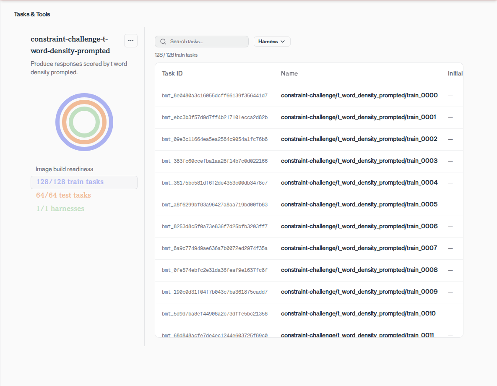

# T Factory: evaluation and training

T Factory asks the model to answer ordinary questions while using as many words beginning with
`T` as possible. Its reward is the fraction of words in the reply that begin with `T`, so it is a
toy that shows reward hacking quickly. [Your first task](README.md) shows the system prompt, the
grader, and one graded call.

This guide uploads T Factory, validates it, then evaluates, trains, and deploys it. For the full
onboarding walkthrough with a real benchmark, follow [GSM8K](../gsm8k/README.md).

Run these commands from the repository root with `TRAJECTORY_API_KEY` set.

## Upload and validate

The benchmark contains 128 training tasks and 64 held-out test tasks.
[Choose or create an agent](https://docs.trajectory.ai/agent). For a new agent:

```bash
uv run --with trajectory-sdk python -c \
  'from trajectory import Client; Client().agents.create(name="t-factory-cookbook")'
```

Upload using its name. The script builds the runtime image, then runs a benchmark diagnostic:

```bash
uv run examples/t_factory/ingest.py --agent-name "t-factory-cookbook"
```



The diagnostic runs up to 10 tasks and prints each task's ending and reward. It passes when it
prints `diagnostic_status=completed`, no task failed, and every task recorded a reward;
otherwise the script prints each task failure and exits with an error.

## Evaluate and train

Replace `YOUR_BENCH_ID` with the printed `bench_id`, then run the baseline evaluation, training,
and final evaluation:

```bash
uv run examples/t_factory/train.py --bench-id YOUR_BENCH_ID
```

Training runs 10 steps on Qwen 3.5 4B with `reasoning_effort` off, four task groups per step,
and the model's default `group_size` of eight attempts per group. The command prints the
`training_run_id`, then `baseline_reward`, `final_reward`, `reward_delta`, how many held-out tasks
recorded a reward in both evaluations, and the reply whose reward rose most, before and after
training. It takes about 20 minutes. The agent's
**Train** and **Compare** tabs show the same runs.

Ten steps is enough for the model to fill most replies with T-starting words. Past that, most
task groups either score `1.0` on every attempt, which leaves nothing to learn from, or lose
attempts cut off at the 2,048-token output limit, which training skips. Finding four trainable
groups for a later step can take hundreds of groups.

## Deploy the trained checkpoint

Create a test deployment from the final checkpoint. Replace the training run ID, and the step
if you changed the default 10 training steps:

```python
from trajectory import Client

client = Client()
checkpoint = client.training.checkpoints.retrieve("YOUR_TRAINING_RUN_ID", step_index=10)
deployment = client.deployments.create(
    checkpoint_id=checkpoint.checkpoint_id,
    test_model_slug="t-factory-trained-test",
)
print(f"deployment_id={deployment.deployment_id}")
```

Follow the [deployment guide](https://docs.trajectory.ai/guides/deployments) to wait for
`DEPLOYED`, query the deployment's test route, and promote it to the agent's production model
slug.

## Observed results

In one 10-step run, `train.py` printed `baseline_reward=0.487` and `final_reward=0.512`. Over the
same 64 held-out replies, T-word density rose from 0.61 to 0.98. Replies also tended to loop: 9
baseline replies and 30 at step 10 repeated phrases until the 2,048-token output limit cut them
off, and evaluation scores a cut-off reply as zero. Baselines in other runs ranged from 0.44 to
0.50, so the change in evaluation reward is within run-to-run noise; the rise in density is the
effect of training.

The task whose reward rose most shows both. Before training, a reply about home cooking looped
until it was cut off:

> Actually, there are tons of terrific tastes that make home cooking tempting. People often think
> that treating themselves to tasty treats is terrific. [...] They think that the total effort is
> terrific. Often, the total time is terrific. People think that the total taste is terrific. [...]

After 10 steps, it scored `1.0`:

> Trying to treat tasty treats, tasty treats taste tasty.

That is reward hacking: the model learns to fill responses with T-starting words. A reward of
`1.0` means every parsed word begins with `T`; it does not imply a useful answer.

The runtime and grader are in
[`t_factory_harness.py`](runtime/t_factory_harness.py).
